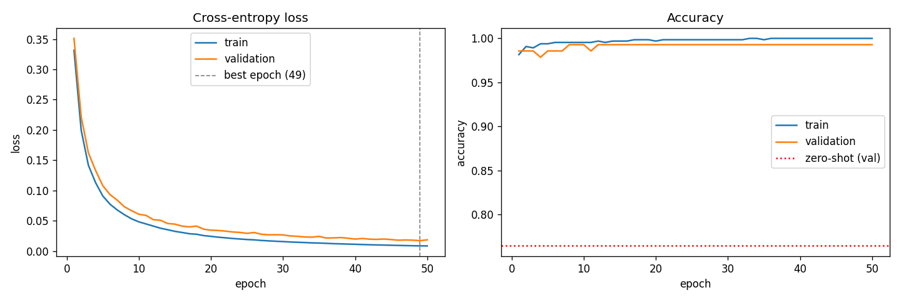
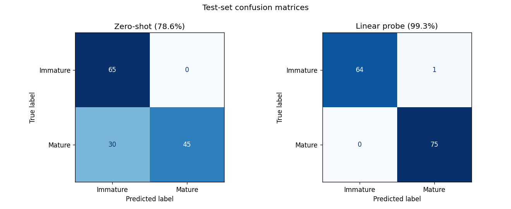

# Computer Vision A — SigLIP Zero-Shot vs Frozen-Backbone Linear Probe on Tomato Maturity

## Task
Binary image classification of tomato maturity (**Immature** vs **Mature**). We measure how much a lightweight linear head trained on a **frozen** SigLIP vision encoder improves over SigLIP's **zero-shot** text-prompt classification.

## Model
[`google/siglip-base-patch16-224`](https://huggingface.co/google/siglip-base-patch16-224) — SigLIP ([Zhai et al., 2023](https://arxiv.org/abs/2303.15343)), a CLIP-style image–text model trained with a **pairwise sigmoid loss** instead of CLIP's batch-wide softmax contrastive loss.

## Dataset
[Tomato Maturity Detection and Quality Grading](https://www.kaggle.com/datasets/sujaykapadnis/tomato-maturity-detection-and-quality-grading) (originally [Mendeley Data](https://data.mendeley.com/datasets/s42kpg8h37/1); [paper](https://pmc.ncbi.nlm.nih.gov/articles/PMC10618421/)). We use the **maturity** subset, **original images only** (~500 Immature + ~500 Mature as published). The provided *augmented* images are transformed copies of the originals and were excluded to prevent train/test leakage. Exact duplicate files were removed by MD5 hash, leaving **931 unique images**. Stratified 70/15/15 split, seed 42 → **651 / 140 / 140** train/val/test.

## Pipeline
1. **Preprocessing:** resize to 224×224 (bicubic) → 14×14 grid of 16×16 patches; HWC → CHW; rescale to [0,1] then normalise with mean = std = (0.5, 0.5, 0.5) → [-1, 1], matching SigLIP pre-training. Verified manual pipeline == `AutoProcessor`.
2. **Zero-shot baseline:** 3 prompts per class, averaged text embeddings, SigLIP logit `cos_sim × exp(logit_scale) + logit_bias`; text tokenised with `padding="max_length"`.
3. **Freezing:** all SigLIP vision (and text) parameters set to `requires_grad = False`.
4. **Linear probe:** `nn.Linear(768, 2)` on the 768-d `pooler_output` (attention-pooled embedding). Embeddings cached once (valid because backbone is frozen and no augmentation is used). AdamW, lr 1e-3, weight decay 1e-4, batch 32, 50 epochs, best epoch chosen by validation loss.

| | Parameters |
|---|---|
| Frozen (vision encoder) | 92,884,224 |
| Trainable (linear head) | 1,538 (0.0017%) |

## Results (held-out test set)
| Method | Test accuracy | Immature P / R | Mature P / R |
|---|---|---|---|
| Zero-shot SigLIP | 78.6% | 0.684 / 1.000 | 1.000 / 0.600 |
| Frozen SigLIP + linear probe | **99.3%** (+20.7 pts) | 1.000 / 0.985 | 0.987 / 1.000 |

Zero-shot validation accuracy: 76.4%. Zero-shot errors are one-directional: 30 of 75 Mature test images predicted Immature, none the other way. The probe makes one error (an Immature image predicted Mature). Best epoch by validation loss: 49/50 (final train / val loss 0.008 / 0.018). Note: 140 test images and a single seed, so one image ≈ 0.7 pts.

## Run it
Open the notebook in Colab (badge above), set **Runtime → T4 GPU**, and *Run all* (~3–5 min). If Kaggle requires auth, add `KAGGLE_USERNAME` / `KAGGLE_KEY` to Colab Secrets. Locally: `pip install -r requirements.txt`.

## Limitations & next steps
Small, single-source dataset; binary task; single seed. Next: multiple seeds with confidence intervals, partial fine-tuning of the last ViT blocks, and the quality-grading task (fresh vs defect).
